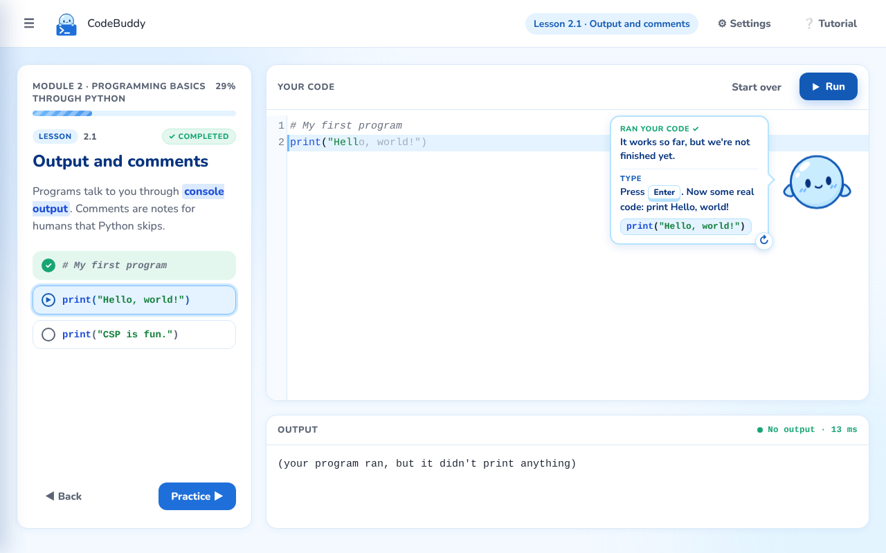
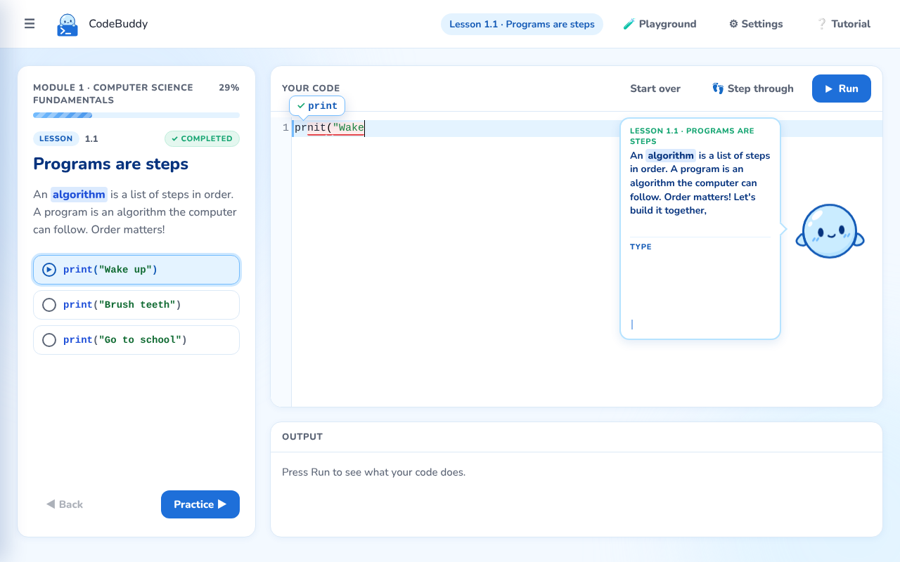
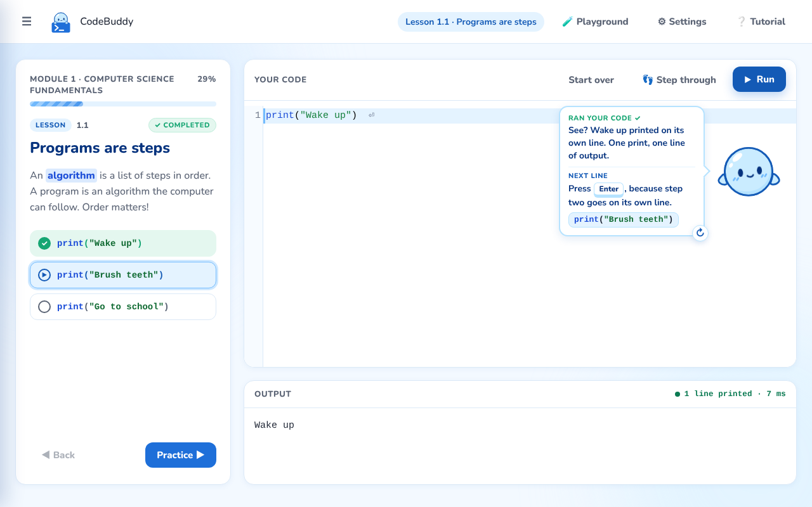
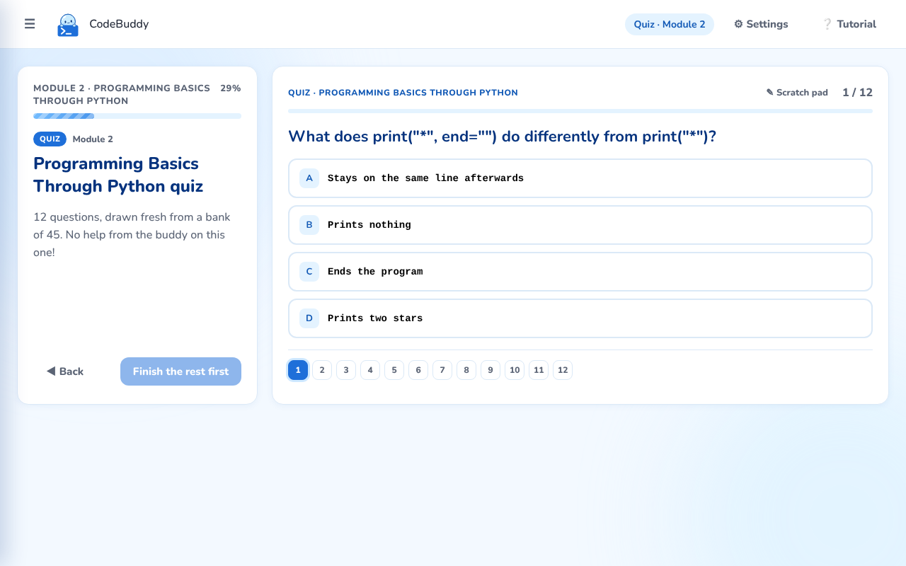
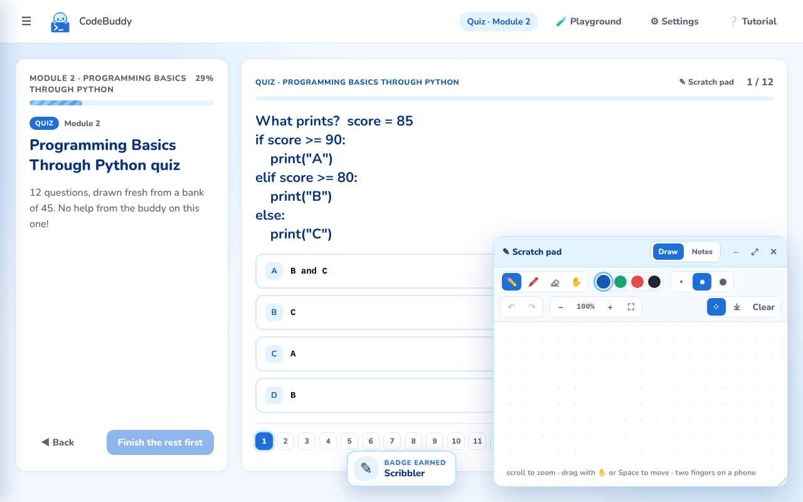
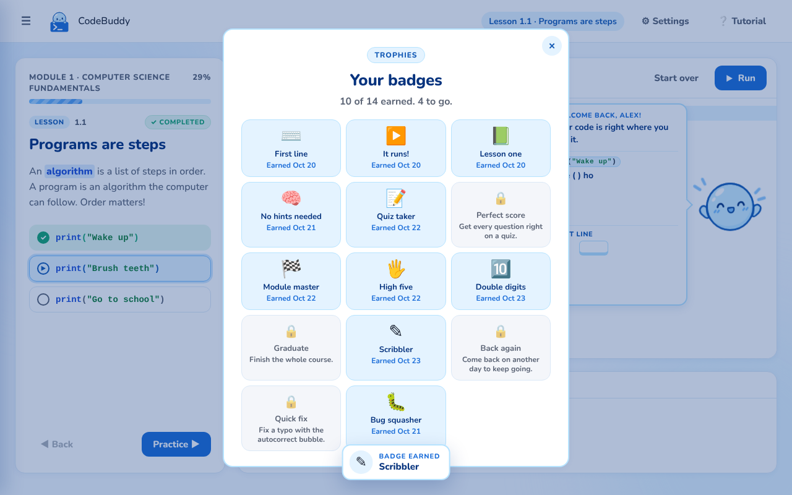
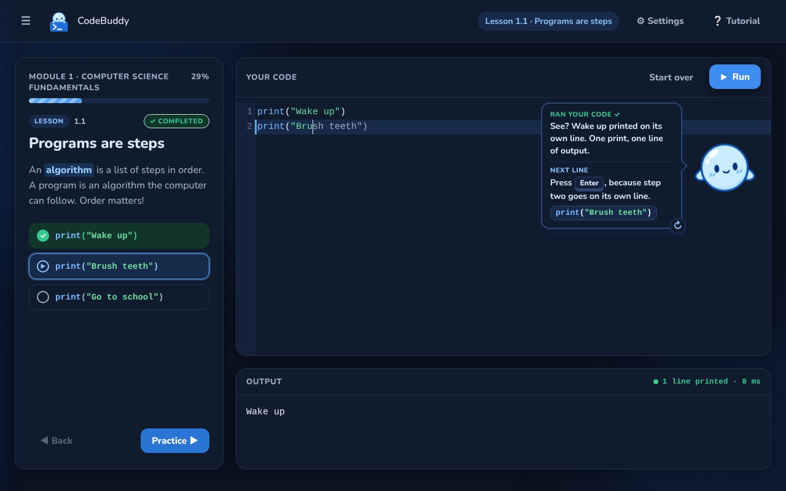
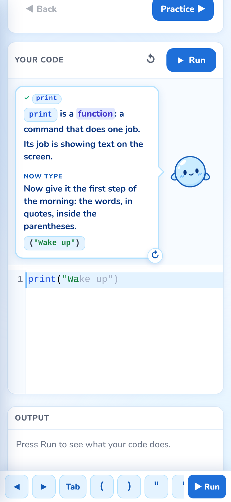

# CodeBuddy

**Learn Python by typing every line, with a friendly buddy who explains each piece as you type it.**

CodeBuddy is a free learn-to-code web app for total beginners. There's nothing to install and no account to make: open the page and start typing real Python. An animated mentor called Buddy floats next to the line you're working on. He tells you what to type next, explains what each piece means, catches typos as they happen, and cheers when your program runs.

Built by Oleksandr Rybitskyi (Folsom High School) for the 2026 Congressional App Challenge.

**Live app:** https://code-buddy-iota-puce.vercel.app



## Why I built it

Most beginner coding sites either hand you finished code to read or drop you into a blank editor. Neither feels like having a tutor next to you. I wanted something closer to a real tutor that's free for anyone: one that watches what you type, knows exactly where you are, and helps at that moment.

## What's inside

**34 lessons in two modules**, each followed by a practice and ending in a module quiz:

- **Module 1, Computer Science Fundamentals:** programs as steps, binary, patterns and compression, logic gates
- **Module 2, Programming Basics Through Python:** output and comments, variables and data types, math and order of operations, f-strings, input, errors, comparisons, `if`/`elif`/`else`, functions, `for` and `while` loops, `break`/`continue` and nested loops, ending in a **final project: a number-guessing game**

That's 10 reading lessons (interactive cards with diagrams and quick checks), 24 guided coding lessons, 24 practices and 2 quizzes, drawn fresh each time from a bank of 70 questions.

## Features

### A tutor that follows your cursor
Buddy moves to the line you're on. Every line is split into small parts (`print`, then `(`, then `"Wake up"`) and he explains each part as you type it. Gray "ghost" letters show what comes next, and they turn real as you type over them.

### Typos fixed like phone autocorrect
When you make a typo, the wrong part gets a red underline and a small bubble appears above it with the right spelling. Tap the bubble and it's fixed. This matters a lot on phones, where fixing one character is painful.



### Real Python, safely in the browser
Code runs with [Pyodide](https://pyodide.org) (real Python 3.14 compiled to WebAssembly) inside a Web Worker, so it can't freeze or touch the page. Infinite loops get stopped after 3 seconds. Some lessons crash **on purpose** so you learn to read an error message and fix it.



### Hover any word to learn it
Hover (or tap, on a phone) a Python word like `range`, `while` or `int` in any editor and a small card explains it in plain words with a tiny example. Words inside strings and comments are left alone.

### Practice, then prove it
After each guided lesson there's a practice with the same idea and no step-by-step help, just a goal, the exact output to match, and 3 hints. Module quizzes mix multiple choice and short coding questions that actually run your code, plus a scratch pad: a whiteboard you can draw on, zoom, pan and resize.

 

### Final project: build a game
The course ends with a guided capstone: a number-guessing game that uses everything (variables, a `while` loop, `int(input())`, `if`/`elif`, a counter and an f-string). When you finish it, Buddy shows how real games use `random` so the secret number changes every time. Its practice is a different game you build on your own: a password checker.

### Reasons to keep going
- **Badges:** 15 achievements, like "No hints needed", "Bug squasher" or "Game maker", each with a pop-up and its own sound
- **Day streak** and per-module progress in the sidebar, plus **lesson search** (titles and what's inside each lesson)
- **Share card** for quiz scores



### A friendly first minute
First-time visitors are greeted by Buddy: what CodeBuddy is in three lines, an optional name (used in his cheers), then a 30-second tour or straight into lesson 1.

### Works everywhere, even offline
- **Installable:** add it to your home screen (Android, iPhone, Chrome, Edge) and it opens full-screen like a native app, with its own icon
- **Offline:** after the first visit everything works with no internet, including running Python. A service worker keeps a copy of the app and of Python (network-first for the app, so updates always arrive)
- **Phones:** a key bar above the keyboard has the symbols Python needs (`( ) " : Tab`) and a Run button
- **Dark mode:** Auto, Light or Dark
- **Saves automatically:** close the tab and Buddy picks up exactly where you left off





### Accessibility and comfort
- Buddy can read his explanations out loud (text-to-speech), with adjustable speed and voice, and the word he's saying lights up as he reads (read-along)
- Code text size, explanation length (short, normal, detailed) and ghost letters are all adjustable
- Keyboard-friendly, with visible focus rings and a shortcuts list (press `?`)
- Respects "reduce motion": turn animations off and the confetti stops too
- Readable contrast in both light and dark themes: zero violations in an automated [axe](https://github.com/dequelabs/axe-core) accessibility scan of every main screen
- Labeled editors for screen readers; decorative effects are hidden from them

## Privacy

There are no accounts, no tracking and no server. Your progress, name and settings live only in your own browser (`localStorage`). Your code runs on your own device.

## How it's built

Plain HTML, CSS and JavaScript. No framework and no build step.

| Part | File | What it does |
|---|---|---|
| Tutor engine | `tutor.js` | Compares what you've typed to the lesson, piece by piece; drives ghost letters, typos, checkpoints and hints |
| Buddy | `buddy.js`, `buddy.css` | Five SVG poses switched with CSS; typewriter speech paced to the voice |
| Python sandbox | `runner.js` | Pyodide in a Web Worker, with `input()` support and a 3-second timeout |
| Lessons | `lessons.js` | All lesson content, practices and quiz banks as plain data |
| Reading lessons | `read.js` | Interactive cards with diagrams and checks |
| Quizzes | `quiz.js` | Random draw from the bank, runnable coding questions, review and retake |
| Scratch pad | `scratch.js` | Infinite whiteboard: pen, highlighter, eraser, zoom, pan, undo, export |
| Badges, share card | `badges.js`, `finish.js` | Achievements, toasts, quiz score share card |
| Icons | `icons.js` | Google Material Symbols, inlined as SVG so they work offline and use the app's colors |
| Effects and sound | `fx.js`, `sfx.js` | Confetti on a canvas; every sound synthesized live with the Web Audio API (no audio files) |
| App shell | `app.js`, `styles.css`, `dark.css` | Layout, sidebar, search, welcome card, settings, phone key bar, themes |
| Word tooltips | `wordinfo.js` | Hover/tap explanations for 38 Python words |
| Installable + offline | `manifest.webmanifest`, `sw.js` | App name, icons and colors; service worker caching for offline use |

**Libraries:** [CodeMirror 5](https://codemirror.net/5/) (vendored in `vendor/`) for the editor, and [Pyodide](https://pyodide.org) (loaded from jsDelivr) for Python.

## Run it locally

Web Workers need a real server (they won't load from `file://`). Any static server works:

```
npx serve .
```

or

```
python3 -m http.server 8000
```

Then open the printed URL. The first visit downloads Python (about 10 MB); after that it's cached.

## Testing

The app was tested with automated browser runs (Playwright) that type through every lesson, practice and quiz, on desktop and on a phone-sized screen, in light and dark mode. They check that every correct answer is accepted, every program prints what the lesson expects, and nothing overflows the screen at 320px wide. Separate checks cover accessibility (axe), the first-visit flow, and loading the app and running Python with the network turned off.

## AI disclosure

I built CodeBuddy with an AI assistant (Claude by Anthropic) as a pair programmer. I came up with the idea, designed how the tutor and Buddy should work, made the product and design decisions, tested it on my own devices, and directed every change. Claude wrote much of the code under that direction and explained it as we went. The Buddy character art (the five poses in `assets/buddy/`) was AI-generated from my design direction. All lesson content was reviewed by me.

## Author

**Oleksandr Rybitskyi**, Folsom High School, Folsom, California
